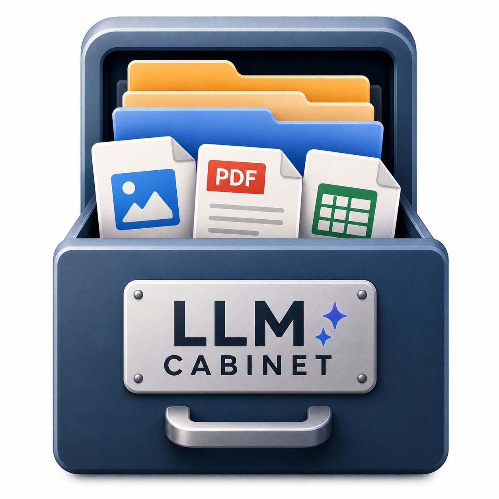
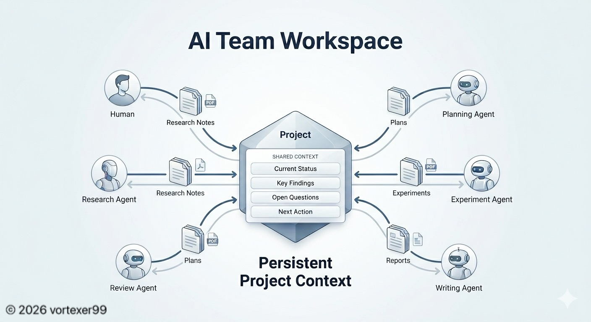
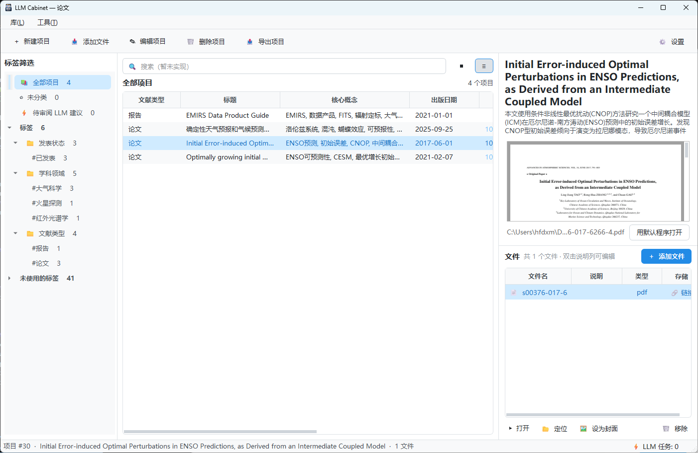
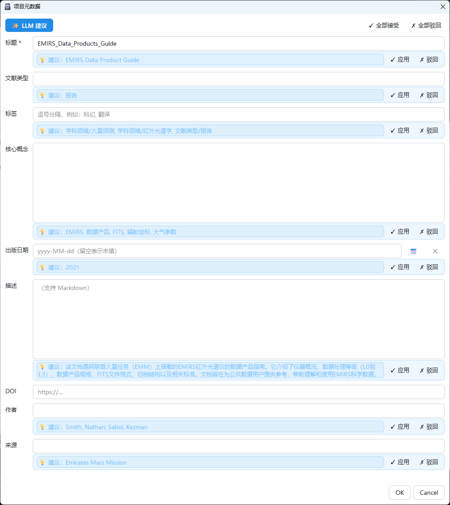
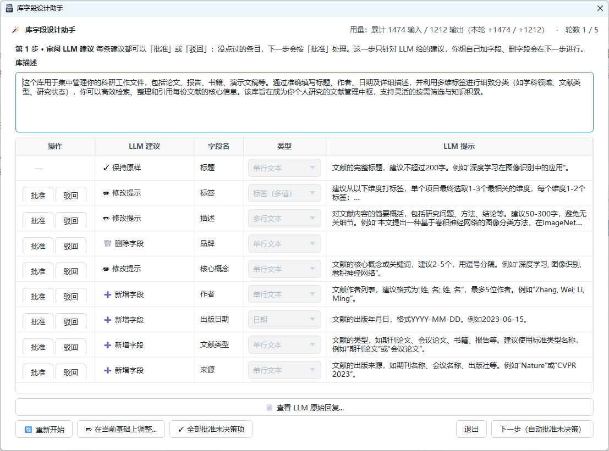
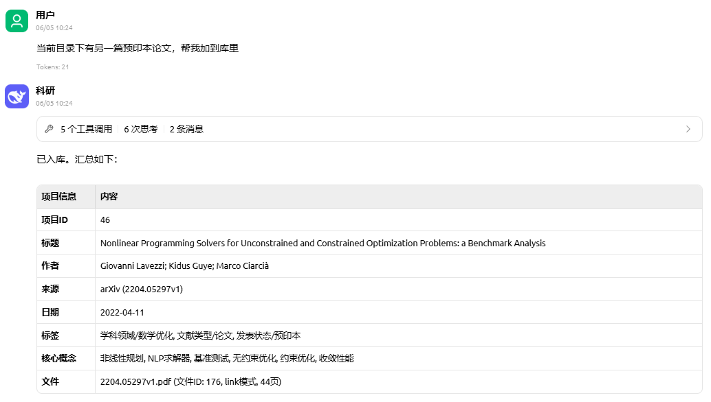
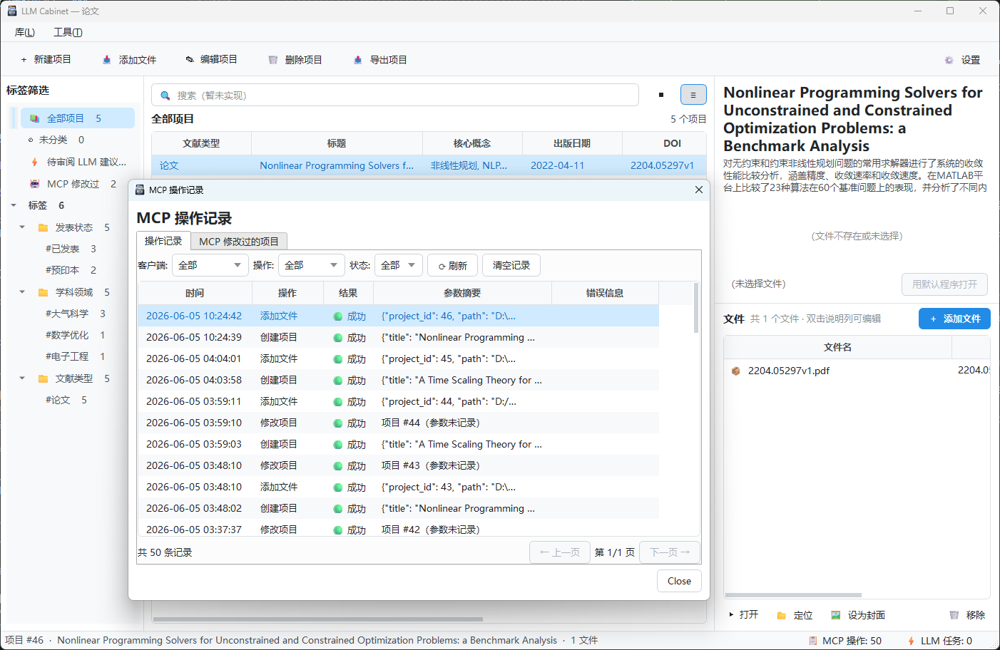

<div align="center">



# LLM Cabinet

A lightweight, project-centric file manager with an AI metadata assistant (Windows desktop).  
Organize files by "project" with custom fields, tags, Markdown descriptions, covers, and multi-provider LLM suggestions.

English · [简体中文](README.zh-CN.md)

</div>

**v0.7.1** (2026-11-20) fixes a Windows packaging error. The 0.7 series adds project favorites and hiding, combined search filters, fullscreen media previews, archive extraction, and a CLI for managing libraries. See the [changelog](CHANGELOG.md#071---2026-11-20) for details.

We plan to phase out built-in model adapters, API key settings, and the LLM request queue so that external tools and AI assistants become the primary way to access project libraries through the CLI or MCP.

## Notice

> **Heads-up — UI is Chinese-only for now.** The application's interface, prompts, and in-app dialogs are written in Simplified Chinese. Due to limited maintainer bandwidth, an English UI is not planned at the moment. This README and [PRIVACY.md](PRIVACY.md) are available in English so you can decide whether the app fits your use case. If you can read Chinese, the app is fully usable; otherwise expect to rely on machine translation for the in-app text.

**This is a personal hobby project; stability is not guaranteed. The author only provides ideas — almost all code is AI-generated. No quality guarantees.**

**Pre-1.0 notice**: versions before 1.0.0 are for early adopters and testing. We do not recommend putting them into heavy daily use — expect breaking changes, rough edges, and occasional data quirks.

**Disclaimer**: The maintainer will continue to support this software, but **assumes no responsibility for any file loss, data corruption, or other damages arising from its use** — including but not limited to abnormal usage, misoperation, system failures, or third-party LLM service issues. Please **keep regular backups** of important data. The software is provided "AS IS", see [MIT License](LICENSE).

## Inspiration

This project is inspired by classic library-style file managers like [Calibre](https://calibre-ebook.com/) — organizing files by "library" with tags and rich metadata is wonderfully efficient, but **the human cost of maintaining metadata is brutal**: typing in titles, authors, tags, and descriptions one file at a time scares most people away. Assigning the right tags takes effort, and so does going back to update existing entries when you add a new field. Even if you skip metadata entirely and just use plain folder hierarchies, **the management cost doesn't go away** — every "what should I name this file?" and "which subfolder does it belong in?" still chips away at your attention.

The recently emerging "LLM-Wiki" idea (see Andrej Karpathy's [LLM Wiki gist](https://gist.github.com/karpathy/442a6bf555914893e9891c11519de94f) and related projects such as [nashsu/llm_wiki](https://github.com/nashsu/llm_wiki)) demonstrates a workflow where **an LLM reads raw source material and autonomously produces & maintains structured entries**. Borrowing that workflow into file management gives us a simple idea: **let a tireless LLM act as the librarian** — first designing a metadata scheme that fits your library (which fields, what format), then doing the per-project reading and upkeep against that scheme.

Compared to LLM-Wiki, **you don't always need the LLM to digest every file** — that burns a lot of tokens, and what you actually want is often just "keep things tidy and findable". LLM Cabinet brings that pragmatic version of the idea to the personal-file-library scenario: keep the Calibre-style project / tag / field abstractions, and hand the most tedious "read-file → fill-metadata" step to an LLM **on demand**, with explicit per-file opt-in.

**Looking ahead**:

- **File preprocessing pipeline**: to further reduce token consumption — and to make non-multimodal models actually useful — there may be a pluggable preprocessing layer that distills raw files into compact "key-information summaries" before sending them to the LLM. Typical forms: extract a few keyframes from videos and treat them as images, run a lightweight local vision model on images to pre-extract tags/captions, run embeddings on very long texts for semantic compression or key-section extraction, and so on.

## Looking Further: AI Team Workspace

As more people connect Cabinet to multiple AI agents (Claude Code, Cursor, custom MCP clients), Cabinet naturally evolves into something bigger than a personal file manager — a **shared memory hub** where Human + multiple Agents collaborate around the same project, reading and writing the same files and metadata even when they cannot talk to each other directly.

<div align="center">
  
  <br/>
  <sub>A project becomes the <b>shared context</b> (current status · key findings · open questions · next action) — every team member, human or agent, reads from and writes to it. Files are the carrier; metadata is the memory.</sub>
</div>

This is a **direction**, not a finished story — Cabinet today is already a usable file manager; the workspace narrative is the path we are gradually building toward (e.g. MCP integration, audit log, provenance tracking are early steps).

## Screenshots

<table>
  <tr>
    <td align="center" colspan="2">
      
      <br/><sub>Main window — tag tree · project list · preview &amp; file table</sub>
    </td>
  </tr>
  <tr>
    <td align="center" width="50%">
      
      <br/><sub>Project edit dialog with inline LLM suggestions (✓ Apply / ✗ Reject)</sub>
    </td>
    <td align="center" width="50%">
      
      <br/><sub>Library field design wizard — Step 1 review LLM suggestions ↔ Step 2 hand-edit the resulting field table</sub>
    </td>
  </tr>
  <tr>
    <td align="center" width="50%">
      
      <br/><sub>MCP integration — agent creates a project with full metadata in one shot</sub>
    </td>
    <td align="center" width="50%">
      
      <br/><sub>MCP audit log &amp; imported project in Cabinet</sub>
    </td>
  </tr>
</table>

## Features

- **Project sizes**: the list view's “项目体积” column shows cached file sizes. Right-click one or multiple projects → “更新项目体积” to total registered linked and managed files in a cancellable background task. Unregistered files and directory contents are excluded; repeated registrations count separately. Click the size header to sort by bytes while preserving selection and preview; unmeasured projects stay last in both directions. Incomplete results show known size and unavailable-file counts. Registration changes mark the cache as needing an update; external file edits require a manual update. Filtering never scans the disk for project sizes.
- **File filters**: sidebar entries for “有视频” (has video), “有压缩包” (has archive), and “有外部链接文件” (has external linked files) use the same tree styling as tags. Click to select, click again to deselect, and select multiple entries without Ctrl. Right-click to match any/all conditions or clear them; Esc also clears this section. All conditions appear in the search box, combined with tags and keywords. Search supports `has:video`, `has:archive`, `has:external`, AND/OR/NOT, completion, and saved searches. External files are identified by their link storage mode, not a project's source URL; different files in a project may satisfy different conditions. “全库” clears the query and all filters. Matching uses registered files, including missing entries; legacy `other` records fall back to video/archive suffixes without reading files or changing records.
- **Hidden projects**: right-click projects in either view → “隐藏项目”; multi-selection is supported. Open “隐藏项目” in the sidebar and choose “取消隐藏” to restore them. Normal browsing, search, favorites, and random browsing exclude hidden projects. Use `hidden:true` for hidden only, `hidden:false` for visible only, or `hidden:all` for both; `1/0` also work. Explicit hidden conditions follow the full AND/OR/NOT expression and can be combined with tags, file types, keywords, and saved searches. Clearing all filters returns to visible projects. The flag persists per library without changing files, favorites, or modification times; export and maintenance retain all records.
- **Project favorites**: click ☆/★ on a grid card, use the project-area favorite button, press Ctrl+D, or use the context menu. Both views support batch favorites. The sidebar lists favorite projects with a count; combine it with file filters and keywords, or search `favorite:true` / `favorite:false`. Favorites persist per library without changing project content or modification times.
- **Random browsing**: “随便看看” selects and scrolls to a random project from the current results, respecting favorites, tags, file conditions, and keywords without changing the filters. It may select the current project again. Pending searches are applied first; empty results disable the button and invalid searches never sample stale results.
- **Layout memory**: each library remembers window size, position, maximized state, panel widths, and the vertical split between preview and files. The layout is restored on restart; detaching and reattaching the file panel also preserves its split.
- **Two extraction progress bars**: separate overall and current-file progress show file counts, names, and processed bytes, including files larger than 2 GB. Unknown totals use indeterminate progress. Cancellation keeps the dialog open until cleanup finishes.

- **Archives**: ZIP, 7Z, RAR, TAR, gzip, bzip2, and xz files are recognized as archives. Right-click an archive → “解压到当前项目…” to extract into a same-name project subfolder as managed files, preserving internal directories and the original archive. Repeated extraction uses numbered folders. Background extraction supports cancellation and asks for passwords only when needed, with retries for incorrect passwords. Older `other` records also receive the archive display and menu based on their suffix, without rewriting the database.
- **Archive password history**: an optional library setting appends the archive name and successful password to the project description only after extraction and registration succeed. It defaults to off. Passwords are stored as plaintext and included when the description is shared or the project exported; disabling the option does not erase earlier entries.

- **Capture a cover without interrupting playback**: setting a cover from the current video frame preserves the selected video, playback position, and playing or paused state; the generated image is not selected automatically.
- **Offline media previews**: for a local database with media on an external drive, unavailable files retain their records and paths. The preview offers retry, detailed errors with copying, and relinking. Background checks cover only the current file. Automatic reconnection restores video position while paused; manual retry respects the previous playback state. PDFs restore their page. Decoding failures are reported separately and read errors do not trigger end-of-playback actions. Changed drive letters require relinking; disconnecting the database itself is outside this preview recovery feature.
- **Cover files**: file lists default to user files, hiding generated covers such as snapshots and clipboard images. Use the source toggle above the list to show all files; saved project filters still apply. Original images used as covers remain visible. Settings → Library lets you keep old cover files (default) or replace them: after the new cover is saved, the previous generated cover goes to the recycle bin. Original images and shared files are retained; earlier covers are not cleaned up retroactively. Failures include file names, paths, stages, and reasons.

- **Video playback continuity**: selecting the video already being previewed preserves its position and paused state. Switching away and selecting it again reloads it using the library's autoplay preference.
- **Video end action**: Settings → Library → Preview behavior offers stop (default), loop the current video, or play the next file. The next file follows the current project order and source filter; videos play automatically, other files show their preview, and the last file stops without wrapping. This per-library preference takes effect immediately and is independent of autoplay on manual selection.

- **Video cover fallback**: enable the optional first-frame setting under automatic covers in Settings → Library. It is available and effective only while the parent setting is on, and defaults to off. If no eligible user image exists, the first video in natural logical-path order supplies a frame saved as a generated PNG in storage. Existing covers and images take priority. Failures, timeouts, or cancellation do not undo the import; existing projects are not changed.

- **File sorting controls**: projects without saved sorting preferences default to natural filename order, including numbers within names or parentheses, such as `name(1), name(2), name(10)`. Click the filename header in tree or flat view to switch direction. Explicit custom drag order is preserved; click the filename header to return to name sorting. Preferences are remembered per project, and existing projects do not need to be reimported.

- **Batch conversion to managed storage**: right-click a project → “项目内所有链接文件转为仓储” to process every file, including subfolders and filtered files. Use Ctrl/Shift to select multiple projects, then right-click a selected project → “所选项目内所有链接文件转为仓储” for one confirmation and one batch summary. You can also select files and use “转为仓储文件” in their context menu. External originals are preserved by default, files already in storage are skipped, and missing files or failures are summarized. When recycling originals is enabled, all batch records are saved before recycling; sources still referenced by other links are kept.
- **Move directly into storage**: Settings → Library offers “链接转仓储时，直接移动原文件”, off by default. It applies to file, folder and single/batch project conversion, takes precedence over recycling, and leaves the original directories. Same-volume moves usually avoid copying; cross-volume moves transfer the data. Shared sources, files already inside the library, and symbolic links are copied with their sources retained, with explanations in the result. New imports retain their existing behavior. Failure details include the full file list, source/destination, stage and exception; failed rollback reports the retained file location.

- **Recycle originals after storage**: an optional per-library setting sends source files to the recycle bin only after copying and saving their records. It applies to subsequent storage imports and link-to-storage conversions and defaults to off. Original folders (including empty ones), files not imported, and ZIP packages imported through extraction are kept. Sources still referenced by links in this library, changed during copying, or already inside storage are also kept with a warning. Recycle failures preserve the originals and do not fall back to permanent deletion.

- **Source links**: double-click a URL field in the project list to open it in your default browser. URL inputs in the project editor also include an open button. Supports source and custom URL fields with complete HTTP(S) addresses.

- **Preview navigation**: previous/next file buttons follow the current file list order and filters, select and reveal the target file, and show its position. Folder nodes are skipped; collapsed parent folders expand when needed. Navigation stops at either end and respects the library's video autoplay setting.

- **Per-library media preferences**: Settings → Library offers automatic cover selection for newly imported projects and autoplay when selecting a video. Both default to off. Covers use the first user image in natural logical-path order, preserve imported covers, and apply to folder/ZIP imports and drag-and-drop project creation. Existing projects are not changed. Video playback uses the current library's setting on each selection.

- **Project-centric organization**: one project groups related files; each file can carry its own per-file note (e.g. "Chinese edition", "page 1")
- **Field system**: 3 protected fields *Title / Tags / Description* are seeded for every library; 4 optional preset fields *Author / Date / Rating / Source* can be checked on at library-creation time; on top of that you can freely add user-defined fields. Reorder, hide, and pick per-field type (text / textarea / date / URL / rating / number) at any time.
- **Library field design wizard**: an LLM-powered wizard (Tools → 🪄 LLM Assistants → Library Field Design Assistant) takes your one-paragraph library description, suggests the right field set, and applies the diff after a two-step review (Step 1 approve/reject LLM suggestions → Step 2 hand-edit the resulting field table).
- **Search and tags**: the search box contains the complete query. Clicking a tag writes an exact condition such as `tag="科幻"`; parent tags use `tag_prefix:"领域"`. Favorites, untagged projects, pending reviews, and unread MCP changes use `favorite:true`, `untagged:true`, `review:true`, and `mcp:true`. Manual edits update the sidebar; copying or saving a query reproduces the same results, and clearing it clears all filters. `tag:科幻` remains a substring match. Keywords search project metadata and registered file names/notes. AND/OR/NOT and parentheses retain their semantics; complex expressions need not select a single sidebar item. “全部项目” removes top-level tag/status conditions while keeping keywords and file filters; “全库” clears everything. Selected projects can still be dragged onto sidebar tags.
- **Search controls**: completion closes when you click elsewhere, move focus away, switch apps, or press Esc. The search clear button stays available for sidebar-generated queries and clears all conditions.
- **Responsive filtering**: covers load as cards become visible. Switching filters retains the selected file and playback state when the current project remains in the results, avoiding unnecessary panel rebuilds.
- **Three-state sidebar tags**: click the same tag to cycle through include, exclude, and no tag filter, shown with drawn check, minus, and hollow-circle icons. Tag groups apply the cycle to the entire prefix. Excluded tags are marked and appear as `NOT` conditions in the search box; other keywords and file filters remain. Enter and Space also cycle. Tags below the project description still select the positive tag filter directly.
- **Combine sidebar tags**: Shift-click another tag to add AND; Ctrl-click to add OR. Selecting A, Shift-clicking B, then Ctrl-clicking C produces `(A AND B) OR C`, with keywords and file conditions still restricting the whole group. Participating tags retain their state icons. Repeated additions of the same positive tag do not duplicate it. A plain click returns to a single tag; Shift takes precedence when both modifiers are held.
- **Tags below the project description**: clickable tags in the upper-right panel filter projects by the exact tag and synchronize the search box and sidebar, keeping other keywords and file conditions. Tags wrap and scroll when needed; hover over a shortened tag to see its full name.
- **Filter by matching field values**: right-click an author or other field value in the project table to find matching projects. Cards offer a “筛选同字段值” submenu, including populated hidden fields. Tags are selectable individually; other fields use their complete stored value. Other search conditions remain, and top-level conditions on the same field are replaced. Empty values and computed columns such as file count and size have no matching-value action.
- **File dragging and order**: moving between folders preserves the current column sort. Reordering within a folder starts from the visible order and keeps other folders in their displayed order. Drops onto the selected file, its existing position, or blank space in the same folder leave the order unchanged. To recover natural order after an earlier drag, click the filename header to select ascending order; this does not restore a changed folder assignment.
- **Custom format groups**: enter `ext:mp4 OR ext:webp OR ext:gif`, click ☆, and name it “有视频类型”. It appears immediately under “自定义筛选” in the sidebar; click it to restore the complete query. Existing saved searches appear automatically, per library. Overwriting a name updates its entry; ⌄ → 删除收藏 removes it. The ⌄ → 收藏 menu remains available. OR matches any format; AND requires all three within a project. Extensions are case-insensitive and accept an optional leading dot. Matching uses registered path suffixes, including missing files and static WebP/GIF images; it does not inspect animation content or reclassify files.
- **Project column sorting**: click any list header to toggle ascending/descending order. Titles, text, tags, and URLs use natural numeric ordering; numbers, ratings, file counts, and sizes sort numerically, while dates sort chronologically. Empty, invalid, and unmeasured values stay last in both directions. Sorting retains selection and preview, survives filter refreshes and field reordering, and clears when its field is hidden or deleted.
- **Preview wheel navigation**: Settings → Library → Preview behavior can make scrolling over the image, video, or PDF select the previous/next file. Scroll up for previous, down for next, following the current file order and filters without wrapping. Off by default, saved per library, and effective immediately; when off, image zoom and PDF scrolling remain available. Volume and other toolbar controls keep their wheel behavior.
- **Animated images**: static WebP displays normally; animated WebP and GIF play automatically with pause/resume controls. Zoom and pan persist between frames, and cover capture uses the current frame. Animation playback is independent of the video autoplay setting.
- **Two storage modes** (per project)
  - `link`: only record the original path; never touch user files
  - `copy`: import a copy into the unified library directory `library/<project_id>/`
- **Focus preview**: click “放大预览” to hide the surrounding panels, or “全屏” for full screen. With focus in the preview, `F` toggles full screen, `Esc` returns one level, left/right selects adjacent files, and Space plays/pauses video or animation. Double-clicking video also toggles full screen. The same player keeps its position and paused state; leaving restores the previous panels and window state. Volume, seek, speed and page controls keep their own keyboard behavior.
- **Select the first file**: Settings → Library → Preview behavior offers “选中项目时自动选择第一个文件”, off by default and saved per library. Selecting a different project selects the first file in the current sorted/filtered list, skipping directories, and follows the video autoplay preference. Re-selecting or refreshing the same project retains the current file and playback.
- **Preview**: inline image / video / PDF preview; other types open with the system default app
- **Drag & drop**: drop files/folders onto blank area to create a new project, onto a project card to attach to it; folder drops default to the folder name as the title. **Dropping multiple folders** lets you choose between "merge into one project" and "one project per folder"; the latter recognizes each folder's `project.json` and restores its metadata. Subdirectory structure is preserved as a virtual tree in the UI.
- **File tree view**: files are organized in a collapsible tree by logical subfolder (`files.subfolder` in DB), decoupled from physical storage. Directories appear as 📁 nodes; tree view supports per-project column sorting, internal drag-and-drop reordering/moving, persistent empty folders, F2/Shift+F2 rename flows, and folder-level storage actions such as convert-to-library-copy, move, and reassociate missing files. Filename sorting uses natural numeric order (`1, 2, 10, 11, 20`) in both tree and flat views; folders also use natural order, while custom drag-and-drop order is preserved. Empty folders dropped in create 0-file projects; deep/large imports trigger a confirmation dialog.
- **LLM metadata assistant** (the headline feature)
  - Built-in adapters for DeepSeek / OpenAI / Google Gemini / xAI Grok
  - One-click field suggestions based on current metadata + your selected reference files (PDF / docx / xlsx / code / images …)
  - Background serial queue with progress; suggestions go into a *pending review* flow — ✓ Apply / ✗ Reject per field, or accept/reject all
  - Per-field switch: disable LLM suggestion for a single field while still passing its current value to the model as context
- **Project export / batch import**: one-click export from toolbar / right-click menu into a
  local directory containing `project.json` / `files.json` / `README.md` / `files/`. Choose
  whether to also copy the original files of link-mode (🔗) entries. The reverse: drop
  multiple project folders onto the bottom DropZone and choose "one project per folder" —
  each `project.json` is recognized and its metadata / fields / tags restored, closing the
  export/import loop.
- **Skill + CLI**: install [`skills/llm-cabinet`](skills/llm-cabinet/SKILL.md) in a client that supports skills and local command execution. Agents can search projects, update metadata, register files, and export projects without starting an MCP server. Each invocation selects its library explicitly; writes require `--write`. See the [setup and command guide](docs/skill.md) (Chinese).
- **MCP Agent integration**: expose your library via [MCP](https://modelcontextprotocol.io/) so
  any compatible client (Claude Desktop / Cursor / Cline / Cherry Studio) can drive an agent
  that searches, creates, and manages projects with metadata — complete with four pre-built
  MCP prompts (organize / audit / summarize / suggest-tags), audit logging, and MCP-modified
  project tracking. Prompt selection depends on the client. Configure from **Settings → MCP**;
  see the [MCP guide](docs/mcp.md) (Chinese).
- **Database**: SQLite — portable, zero-config

## Run

```powershell
python -m venv .venv
.venv\Scripts\activate
pip install -r requirements.txt
python tools/prepare_7zip.py
python -m app.main
```

Once dependencies are installed, you can also run `powershell -ExecutionPolicy Bypass -File .\start.ps1` from the project root. The script uses the project's `.venv` automatically; keep the terminal open while the app is running.

Switching libraries restarts the app automatically. Source installations restart through the absolute `run.py` entry point to preserve package imports, including when launched with `start.ps1` or `python -m app.main`. If restarting fails, the dialog includes launch arguments and exception details; restarting manually opens the selected library.

> Requires Python 3.10+. On first launch the app shows a Welcome dialog: pick a directory to create a brand-new library (a multi-step wizard collects the library description, default storage mode, optional preset fields, etc.) or open an existing one. The chosen library directory holds `cabinet.db` + `library/` + a `.llm-cabinet` marker; inspect the current paths under **Settings → Library**, and use **Library → Switch Library** to relocate or jump between libraries.

For source installations, `tools/prepare_7zip.py` downloads and verifies a pinned official 7-Zip release into `.tools/7zip/`, without system installation or PATH changes. Packaged Windows executables include the decoder. Without this preparation, basic ZIP/TAR extraction remains available, while 7Z/RAR and encryption support depend on existing system tools. The running application does not download components automatically.

## Use with an agent

Copy the entire `skills/llm-cabinet/` folder into your client's skills directory. Keep the project source and Python environment installed; the skill package does not bundle the application. From the repository root:

```powershell
.\.venv\Scripts\python.exe skills/llm-cabinet/scripts/cabinet.py libraries list
.\.venv\Scripts\python.exe skills/llm-cabinet/scripts/cabinet.py --library "My Library" projects search --keyword "report"
```

For an installed copy of the skill, pass `--app-root "D:\path\to\LLM-Cabinet"` before the command, or set `LLM_CABINET_HOME` to that project directory. Use the project's Python interpreter. All global options precede the subcommand. Except for `libraries list`, specify `--library NAME` or `--db PATH` on every call. Add `--write` for a write operation or export, and `--allow-file-read` to read file contents. Results are UTF-8 JSON; failures return a nonzero exit code. The same CLI is available as `python -m app.cli` from the project root. See [docs/skill.md](docs/skill.md) for installation, permissions, and file-registration semantics.

MCP remains available for clients that use MCP tools and resources; configure it under **Settings → MCP**.

## Data Privacy

LLM Cabinet is a local-first app — all project data lives on your machine. Network calls happen **only when you explicitly trigger "LLM metadata suggestion"** to the LLM provider you yourself configured. For the full data-flow breakdown, the controls you have, and known caveats, see [PRIVACY.md](PRIVACY.md) ([简体中文](PRIVACY.zh-CN.md)).

## Configure LLM

Open **Settings → API**:
1. Fill in the `API Key` for the provider(s) you want to use (other fields auto-fill defaults)
2. Click **🔌 Test Connection** (only does a lightweight `GET /models`, doesn't consume inference quota)
3. Pick your **default provider** and **default language**

Then trigger suggestions from:
- The **✨ LLM Suggest** button in the project edit dialog, or
- Right-click a project in the list → **LLM Metadata Suggestion…**

## Package as a single .exe

```powershell
pip install pyinstaller
python tools/prepare_7zip.py
pyinstaller -w -F -n "LLM Cabinet" `
  --icon icon.ico `
  --add-data "icon.ico;." `
  --add-data "icon.jpg;." `
  --add-data "PRIVACY.md;." `
  --add-data "PRIVACY.zh-CN.md;." `
  --add-data "app/ui/assets;app/ui/assets" `
  --add-binary ".tools/7zip/7z.exe;tools/7zip" `
  --add-binary ".tools/7zip/7z.dll;tools/7zip" `
  --add-data ".tools/7zip/License.txt;tools/7zip" `
  --add-data ".tools/7zip/readme.txt;tools/7zip" `
  --add-data ".tools/7zip/THIRD_PARTY_NOTICES.txt;tools/7zip" `
  run.py
```

> The repo ships an `icon.ico` (multi-resolution: 16/32/48/64/128/256, 32-bit RGBA). If you replace it, keep the multi-size layout so the app icon stays crisp across all Windows views.

The resulting `dist/LLM Cabinet.exe` is portable.

## Project Layout

```
app/
├── main.py            entry point
├── cli.py             JSON CLI for skills and local agents
├── db.py              SQLite connection, schema & migrations
├── models.py          dataclasses
├── repository.py      data access layer
├── library.py         library directory & file landing strategy
├── library_check.py   library consistency check / backup / restore
├── cabinet.py         multi-library registry (recent / switch / delete)
├── exporter.py        project export (directory format + project.json)
├── importer.py        batch folder import (recognizes project.json)
├── utils.py
├── mcp/
│   ├── server.py              MCP server (17 → 5 aggregate tools)
│   ├── standalone.py          standalone entry point
│   ├── tools.py               tool implementations
│   ├── prompts.py             MCP prompt templates
│   ├── resources.py           data resources
│   ├── context.py             library context & switching
│   └── skills/                MCP prompt instructions (organize / audit / summarize / suggest-tags)
├── llm/
│   ├── config.py      LLM config (providers + defaults)
│   ├── providers.py   DeepSeek / OpenAI / Gemini / Grok adapters
│   ├── prompts.py     prompt templates
│   ├── context.py     prompt assembly + text extraction (pdf/xlsx/docx/code/…)
│   └── queue.py       background task queue
└── ui/
    ├── main_window.py        3-pane main UI (tag tree / project list / preview + files)
    ├── welcome_dialog.py     first-launch / "no library open" entry
    ├── project_dialog.py     project metadata editor + suggestion review
    ├── llm_suggest_dialog.py LLM trigger dialog (pick reference files & target fields)
    ├── llm_tasks_panel.py    task queue panel
    ├── mcp_audit_dialog.py   MCP audit log viewer
    ├── export_dialog.py      project export dialog
    ├── import_dialog.py      batch folder import dialog
    ├── folder_drop_mode_dialog.py  "merge / separate" picker for multi-folder drops
    ├── settings_dialog.py    settings (general / library / view / fields / API / MCP / about)
    ├── about_dialog.py
    ├── tag_tree.py
    ├── preview.py            inline image / video / PDF preview
    ├── project_card.py       grid view model + card painting
    ├── files_table_columns.py
    ├── first_run_banner.py
    ├── theme.py              light / dark palette + QSS
    ├── wizard_list_dialog.py LLM-assistant wizard launcher
    ├── wizards/              LLM assistants (library field design wizard, …)
    └── widgets.py
```

The installable agent skill lives separately in [`skills/llm-cabinet/`](skills/llm-cabinet/SKILL.md).

> Developer end-to-end self-check scripts live in [`selftests/`](./selftests/README.md) (run manually, not in CI).

For manual feature testing, generate a complete sample library with:

```powershell
python tools/create_sample_library.py --target sample-library --force
```

Then open `sample-library/` from **Library → Switch Library**. See [`docs/sample-library.md`](./docs/sample-library.md) for the covered scenarios.

## Moving & Syncing Your Library

Each LLM Cabinet library is **one self-contained directory** (containing `cabinet.db` + `library/` + a `.llm-cabinet` marker). **No export/import needed to relocate**:

1. Close LLM Cabinet
2. In your file manager, **cut & paste** the entire library directory to the new location (other drive, network drive, USB stick)
3. Reopen LLM Cabinet, choose **Library → Switch Library** and pick the new location

Cross-device syncing (OneDrive / Dropbox / etc.) works the same way. **Caveat**: only one client may have the library open at a time (SQLite single-writer lock). Keep the app closed while the sync agent finishes uploading to avoid write conflicts.

For point-in-time snapshots, use **Tools → 📦 Backup this library**; restore with **Tools → 📥 Restore library from backup** by picking the zip + an empty target directory. Backups use a database snapshot with configured API keys removed, excluding SQLite sidecars and old migration backups (`cabinet.v*.bak`). Re-enter API keys after restoring, including on the same machine. User files are copied unchanged; check their contents before sharing. Avoid changing library files while a backup runs.

Deleting stored files or projects sends files to the recycle bin. If that fails, deletion becomes permanent; the confirmation explains this and the result dialog lists affected files.

## FAQ

### Taskbar icon looks wrong on first launch

The first time you launch a new build of the exe, the Windows taskbar may briefly show a default / generic icon instead of the app icon. **Just close the program and reopen it once** — the icon will be correct from then on. This is a well-known interaction between the Windows icon cache and PyInstaller onefile builds; functionality is not affected.

## License

[MIT](LICENSE) © 2026 vortexer99
