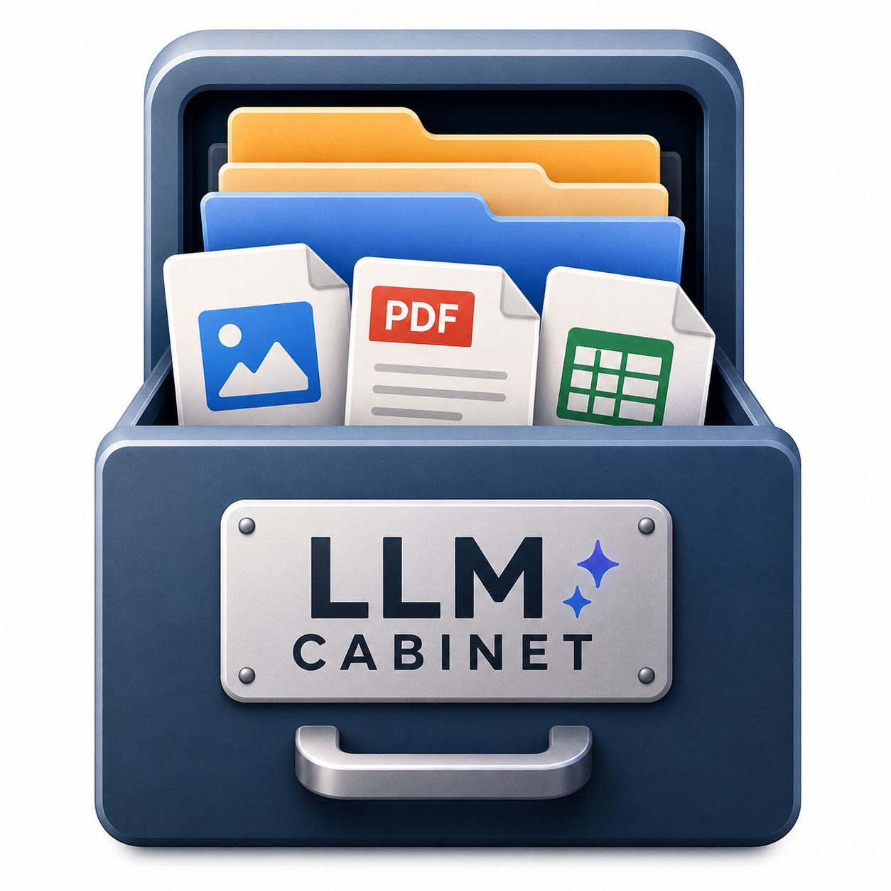
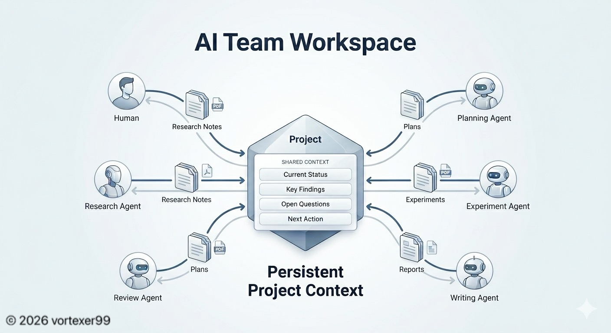
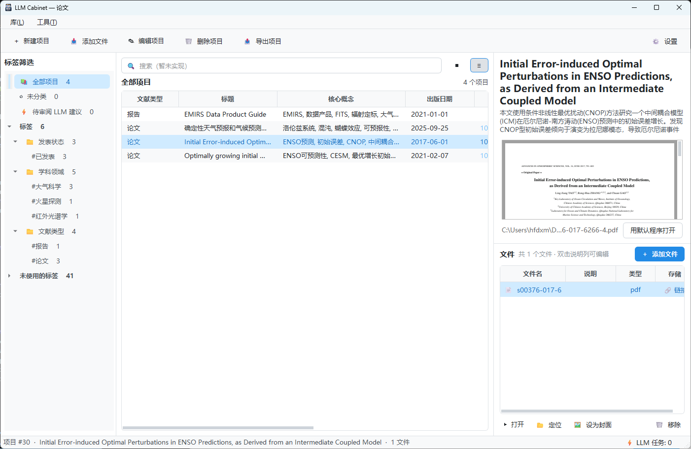
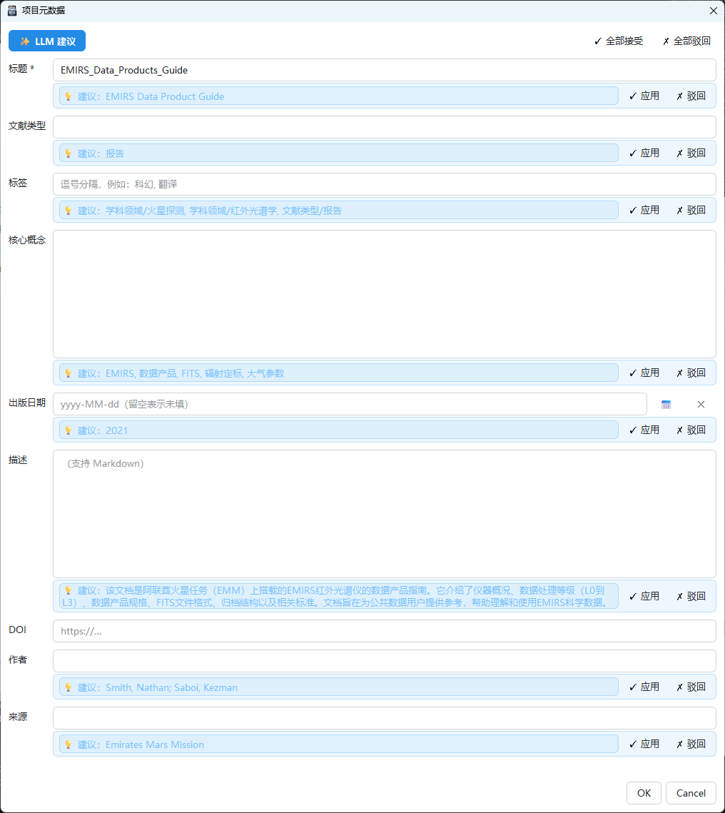
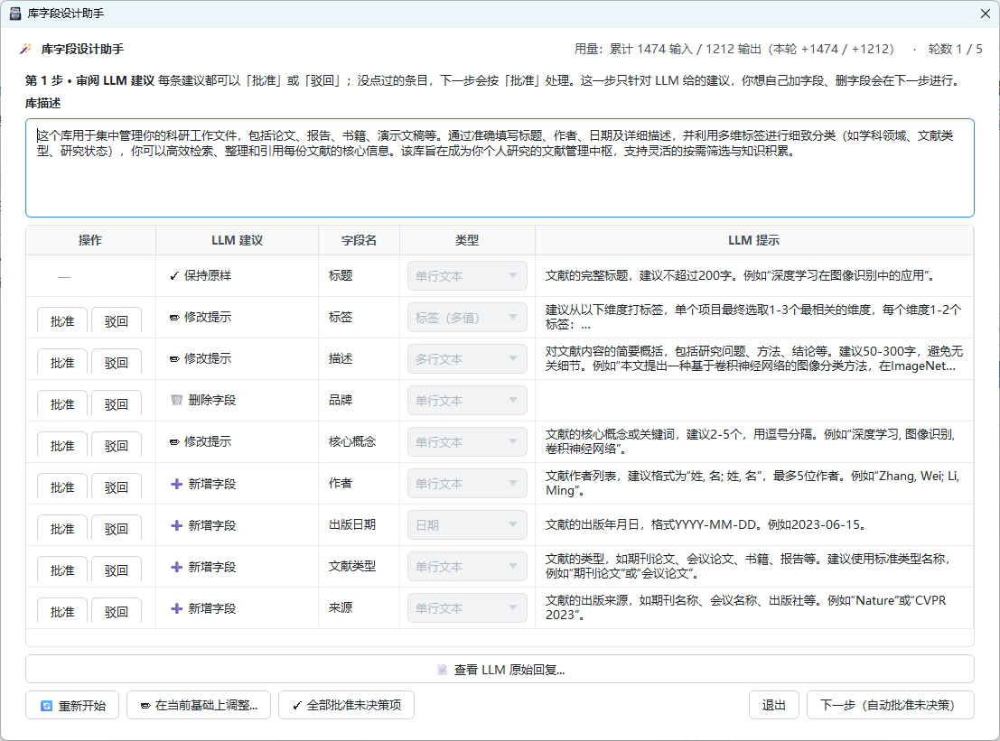
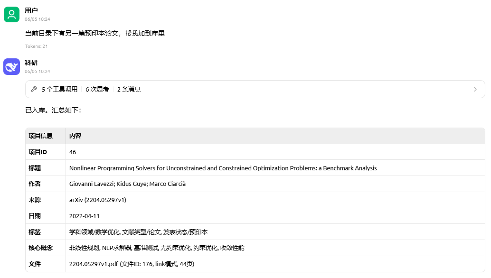
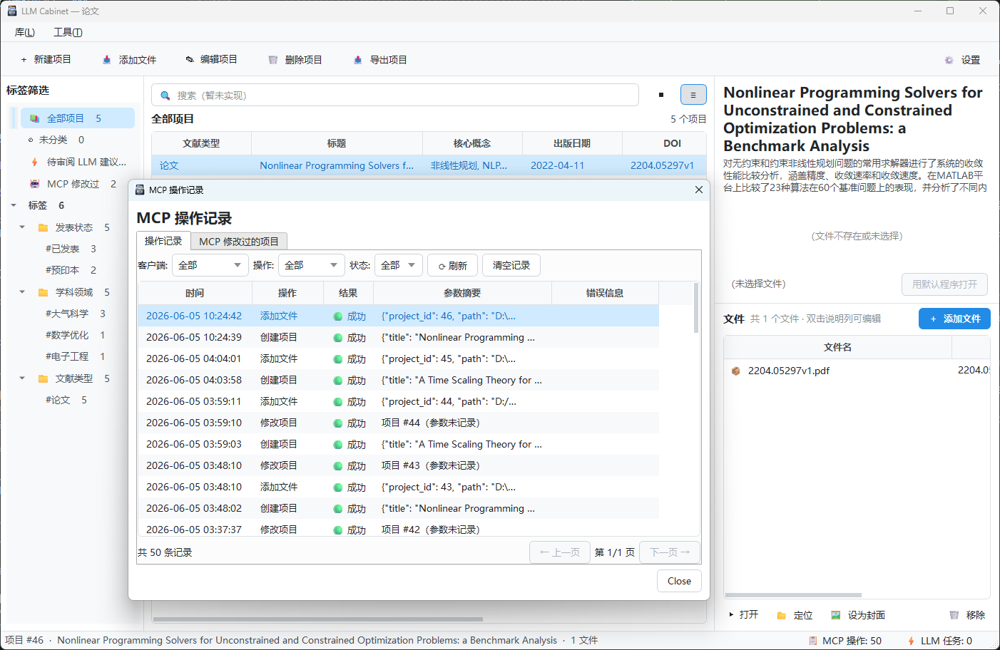

<div align="center">



# LLM Cabinet

带 AI 元数据助手的轻量级项目化文件管理器（Windows 桌面）。  
按"项目"组织文件，支持自定义字段、标签、Markdown 描述、封面与多模型 LLM 建议。

[English](README.md) · 简体中文

</div>

**v0.7.0**（2026-11-20）新增项目收藏与隐藏、组合筛选、全屏媒体预览、压缩包解压，以及管理项目库的命令行工具。详见[更新日志](CHANGELOG.md#070---2026-11-20)。

未来计划逐步退役内置模型适配、API Key 设置和 LLM 调用队列等功能，项目库将主要供外部工具和 AI 助手通过 CLI 或 MCP 调用。

## 注意

**本项目为个人项目，不保证稳定性。本人仅为项目提供idea，具体实现几乎全部由AI生成，不保证代码质量。**

**1.0.0 前须知**：当前版本为尝鲜预览版，不建议投入重度日常使用——可能存在破坏性变更、体验粗糙、偶尔的数据问题。

**免责声明**：本人将持续维护本软件，但**不对任何使用过程中**（包括但不限于异常使用、误操作、系统故障、第三方 LLM 服务异常）**导致的文件丢失、数据损坏或其他损失承担责任**。请通过**定期备份**保护重要数据。本软件按"原样"提供，详见 [MIT License](LICENSE)。

## 灵感来源

本项目灵感源于传统文件管理器 [Calibre](https://calibre-ebook.com/)——按"书库"的方式做标签化文件管理非常高效，但**维护元数据的人力成本极高**：一个个手动填标题、作者、标签、描述，往往让人望而却步。给文件分配合适的标签需要精力，新增一个字段时回过头维护已有条目同样需要精力。即使完全不用元数据、只靠传统的文件夹层级管理，**管理成本也并未消失**——文件名应该怎么起、放在哪一级目录下合适，每一次决策都在消耗注意力。

随着"LLM-Wiki"概念兴起（参考 Andrej Karpathy 的 [LLM Wiki gist](https://gist.github.com/karpathy/442a6bf555914893e9891c11519de94f) 以及 [nashsu/llm_wiki](https://github.com/nashsu/llm_wiki) 等相关实践）：借鉴这类项目"**让 LLM 自动读取原始资料、产出并维护结构化条目**"的工作流形式——把它搬到文件管理场景里，就是**让不会疲倦的 LLM 作为文件管家**：先帮你设计一套适合当前库的元数据方案（哪些字段、什么格式），再按这套方案对每个项目做读取与维护工作。

相比 LLM-Wiki，**很多时候你并不需要让 LLM 消化吸收所有文件**——那会消耗大量 token，而你的真实诉求可能只是"把它们放得整齐一点、找的时候能找到"。LLM Cabinet 正是这个思路在"个人文件库"场景下的落地：保留 Calibre 式的项目/标签/字段抽象，把最枯燥的"读文件 → 填元数据"那一步可选地交给 LLM。

**未来设想**：

- **文件预处理流水线**：为了进一步降低 token 消耗、以及在不支持多模态的模型上也能取得较好效果，未来可能开放预处理接口——把原始文件先压缩成"关键信息摘要"再发给 LLM。典型形式包括：视频抽取若干关键帧再当作图像处理、图像先经轻量本地视觉模型提取标签/描述、超长文本通过嵌入模型做语义压缩或抽取关键段，等等。

## 更远的设想：AI Team Workspace

随着越来越多用户把 Cabinet 接到多个 AI agent（Claude Code / Cursor / 自定义 MCP 客户端），Cabinet 会自然地从"个人文件管理器"长成另一个东西——一个**共享记忆中枢**：人类和多个 Agent 围绕同一个项目协作，读写同一份文件与元数据，即使这些 Agent 之间彼此并不能直接通信。

<div align="center">
  
  <br/>
  <sub>项目本身成为 <b>共享上下文</b>（当前状态 · 关键发现 · 开放问题 · 下一步动作）——人类和每一个 Agent 都从这里读、往这里写。文件是载体，元数据是记忆。</sub>
</div>

这是一个**方向**，不是已完工的故事——Cabinet 现在就已经是一个可用的文件管理器；上面这张工作台愿景是我们正在一步步往那走（MCP 接入、操作审计、来源链追溯都是早期铺路工作）。

## 截图

<table>
  <tr>
    <td align="center" colspan="2">
      
      <br/><sub>主界面：标签筛选 · 项目列表 · 预览与文件表</sub>
    </td>
  </tr>
  <tr>
    <td align="center" width="50%">
      
      <br/><sub>项目编辑对话框，逐字段展示 LLM 建议（✓ 应用 / ✗ 驳回）</sub>
    </td>
    <td align="center" width="50%">
      
      <br/><sub>库字段设计助手：Step 1 审阅 LLM 建议 ↔ Step 2 编辑应用后的字段表</sub>
    </td>
  </tr>
  <tr>
    <td align="center" width="50%">
      
      <br/><sub>MCP 集成 — Agent 端：一句话让 agent 自动创建项目并填写完整元数据</sub>
    </td>
    <td align="center" width="50%">
      
      <br/><sub>MCP 集成 — Cabinet 端：操作记录对话框 + 已入库的项目</sub>
    </td>
  </tr>
</table>

## 特性

- **项目体积**：列表视图新增“项目体积”列。右键单个或多选项目 →“更新项目体积”，在可取消的后台任务中统计已登记的链接及仓储文件大小；未登记文件、目录内容不计，同一路径重复登记按记录分别累计。点击体积列标题按真实字节升降序，保留选择和预览，未统计项目在两个方向都排最后。缺失或不可访问时显示已知大小及缺失数；登记新增、移除或路径变化后标为“待更新”。磁盘上的外部改动需手动重算，筛选不会为体积统计扫描磁盘。
- **文件筛选**：左侧“有视频”“有压缩包”“有外部链接文件”与标签采用相同条目样式，点击高亮，再次点击取消，可直接多选。右键切换满足任一／同时满足全部条件，右键“清除文件筛选”或在该区域按 Esc 清除；与标签和关键词叠加，所有条件同步到搜索框。也可输入 `has:video`、`has:archive`、`has:external`，支持 AND／OR／NOT、补全及收藏搜索。`has:external` 按文件的链接存储模式判断，不匹配项目来源网址；组合条件可由项目内不同文件分别满足。“全库”清空搜索与筛选。按已登记文件判断（包含缺失文件），旧 `other` 记录兼容视频／压缩扩展名，无需读取文件或修库。
- **隐藏项目**：在列表或网格中右键项目 →“隐藏项目”，支持多选。左侧“隐藏项目”可找回，右键“取消隐藏”恢复。普通浏览、搜索、收藏及“随便看看”默认排除隐藏项；输入 `hidden:true` 仅看隐藏，`hidden:false` 仅看可见，`hidden:all` 包含全部，可组合标签／类型／关键词并保存到左侧。`true/false` 也支持 `1/0`，显式 hidden 条件遵循完整 AND／OR／NOT 逻辑；“全库”清空后回到普通可见范围。状态按库持久化，不改变文件、收藏或项目更新时间；导出和维护仍保留全部记录。
- **项目收藏**：点击网格卡片右上角 ☆／★ 一键收藏或取消；网格和列表均可通过项目区“收藏”按钮、Ctrl+D 或右键菜单操作，多选可批量收藏。左侧“收藏项目”显示数量，可叠加文件筛选与关键词；搜索支持 `favorite:true`／`favorite:false` 及布尔组合。收藏是当前库的个人标记，重启保留，不改变项目内容或更新时间。
- **随便看看**：点击项目区“随便看看”，随机选中并定位当前筛选结果中的一个项目；遵循收藏、标签、文件条件和关键词，保持原筛选，可能再次选中当前项目。输入搜索后立即点击也会先应用搜索；空结果禁用，语法错误不会随机选择旧结果。
- **布局记忆**：按库记住窗口大小、位置、最大化状态、左右栏宽及右侧预览／文件列表的上下比例；重启后恢复，文件列表弹出再收回也保留上下比例。
- **解压双进度**：解压窗口分别显示整个压缩包和当前文件的进度、已处理大小及文件名；支持大于 2 GB 的文件。无法提前获取总量时显示不定进度，取消后等待清理完成再关闭。

- **压缩包**：识别 ZIP／7Z／RAR／TAR 及 gzip、bzip2、xz 等压缩文件。文件右键“解压到当前项目…”会在当前项目的同名子文件夹登记仓储文件，保留内部目录与原包；重复解压自动编号，不覆盖已有内容。支持后台解压及取消，遇密码再询问、错误可重试。旧记录即使为 `other`，文件列表也按后缀显示压缩包并提供入口，无需修库。
- **解压密码记录**：设置 → 项目库可开启“在项目描述中记录成功使用的解压密码”，默认关闭；仅解压并入库成功后，在原描述末尾追加包名和本次成功密码。密码为明文，项目导出和分享描述时会包含；关闭选项不会删除已有记录。

- **截图设封面**：从视频当前画面设置封面后，继续保持原视频选择、播放进度和播放/暂停状态，不切换到生成的封面图片。
- **外置文件离线预览**：适用于数据库在本机、媒体在外置盘的库。无法访问文件时保留文件记录和路径，在预览区重试、查看／复制详细错误或重关联；后台仅检查当前预览文件。自动重连恢复视频位置并保持暂停，手动重试按断开前的播放状态恢复，PDF 恢复页码。解码错误单独提示，读取失败不会触发播完动作；盘符改变需手动重关联。数据库本身断盘不属于此预览恢复功能。
- **封面文件管理**：项目文件清单默认仅显示用户文件，隐藏截图／剪切板等生成封面；点击清单上方来源按钮可查看全部文件，已保存的项目来源筛选继续生效。原始图片用作封面时仍显示。设置 → 项目库 →“更换封面时”可选择保留旧封面文件（默认）或替换：新封面保存成功后，将上一张生成封面移到回收站；原始图片、共享文件保留，不追溯清理更早的封面。失败详情列出文件、路径、阶段和具体原因。

- **视频播放保持**：重复选中当前预览的视频不会重新加载或从头播放，也不会打断暂停状态；切换文件后再选回来时，才按当前库的自动播放设置重新加载。
- **视频播完动作**：设置 → 项目库 → 预览行为可选停止（默认）、循环当前视频、播放下一个文件。下一文件遵循当前项目排序和来源筛选，视频自动续播，其他文件显示预览；末尾停止、不绕回或跨项目。按库保存、修改立即生效，独立于手动选中视频的自动播放开关。

- **视频自动封面**：在设置 → 项目库的“自动封面”下可勾选视频首帧子选项（默认关闭），主开关开启时才能选择并生效。没有可用用户图片而有视频时，按逻辑目录和文件名自然顺序选择第一个视频，截取首帧为库内衍生 PNG；已有封面和图片优先。不修改历史项目，失败、超时或取消不影响入库。

- **文件排序操作**：没有排序偏好的项目默认按文件名自然升序，数字在名称中间或括号内也按数值排列，例如 `名称(1)、名称(2)、名称(10)`。树形和平铺视图均可点击“文件名”列标题切换升降序，按项目记住排序；明确保存的自定义拖拽顺序保持不变，点击文件名表头即可切回名称排序。旧项目无需重新导入。

- **批量转仓储**：右键项目 →“项目内所有链接文件转为仓储”，处理整个项目（含子目录和被过滤的文件）；按 Ctrl／Shift 多选项目后，在选中项上右键 →“所选项目内所有链接文件转为仓储”，一次确认并汇总整批结果。也可在文件表多选后右键“转为仓储文件”。外部文件复制进库，默认保留原文件，已仓储文件自动跳过，缺失或失败项在结果中汇总；开启原文件回收时，整批保存后再回收，仍被其他链接引用的源文件保留。
- **直接移动转仓储**：设置 → 项目库可开启“链接转仓储时，直接移动原文件”，默认关闭。适用于文件、文件夹及单个／多个项目转换，优先于回收设置，不经过回收站；原目录保留，同盘通常无需复制，跨盘仍需传输。共享源、仓库内部文件、符号链接等会复制并保留源文件，在结果中说明；新导入沿用原设置。失败详情提供完整文件清单、源／目标路径、失败阶段及异常；回滚失败会注明文件保留位置。

- **仓储后回收原文件**：设置 → 项目库可开启“仓储存入成功后，将原文件移入回收站”，默认关闭、按库保存，适用于后续仓储导入和链接转仓储。先复制并保存记录，再回收原文件；保留原目录（含空文件夹）、未导入文件及 ZIP 解包导入的原包。本库仍有其他链接引用、源文件发生变化或源文件位于仓库内部时保留并提示。回收失败不影响已入库副本，不会退回永久删除。

- **来源链接**：项目列表中双击 URL 字段可在默认浏览器打开；项目编辑窗口的 URL 输入框右侧也有打开按钮。适用于来源及自定义 URL 字段，需填写完整的 HTTP(S) 网址。

- **预览翻页**：右上角“上一个文件 / 下一个文件”按当前列表排序和过滤范围切换，同步选中、定位文件并显示当前位置；跳过目录节点，自动展开目标父目录，首尾不循环，视频沿用当前库的自动播放设置。

- **库级媒体偏好**：设置 → 项目库可开启“导入项目时自动用第一张图片作为封面”和“选中视频时自动开始播放”，两个开关默认关闭、按库保存。自动封面按逻辑目录和文件名自然顺序选择第一张用户图片，适用于文件夹/ZIP 导入与拖放新建项目；保留导入包原封面，不补改历史项目。自动播放在下次选中视频时读取当前库设置。

- **项目化组织**：一个项目对应一组相关文件，每个文件可独立填写说明（如"中文版"、"第一页"）
- **字段系统**：每个库默认 seed 3 个受保护字段——标题 / 标签 / 描述；新建库向导第 3 页可勾选 4 个预置字段——作者 / 日期 / 评分 / 来源；在此之上可自由新增用户字段。所有字段都能排序、隐藏、按类型（文本/多行/日期/URL/评分/数字）配置。
- **库字段设计助手**：内置 LLM 向导（工具 → 🪄 LLM 助手 → 库字段设计助手），把你写的一段"这个库用来管什么"描述作为输入，LLM 给出字段集建议；两段式审阅（Step 1 逐条批准/驳回 LLM 建议 → Step 2 自由编辑应用后的字段表）后一键落库。
- **标签**：作为多值字段一等公民，左栏可按标签筛选。切换筛选时按需加载可见卡片封面；当前项目仍在结果中时，保留选中文件和播放状态，减少重复刷新。
- **标签三态筛选**：左侧同一标签连续点击，依次为“包含该标签 → 不包含该标签 → 不筛选”，第四次回到包含；状态图标分别为勾、减号、空心圆。标签分组按整个前缀轮切；排除状态显示“不包含”，搜索框同步 `NOT` 条件。保留其他关键词和文件条件，回车／空格也可轮切；简介中的标签仍用于直接筛选包含该标签的项目。
- **标签组合筛选**：Shift 点击其他标签为 AND（同时满足），Ctrl 点击为 OR（满足任一）；例如 A → Shift 点 B → Ctrl 点 C 得到 `(A AND B) OR C`，关键词和文件条件继续限制整个组合。组合内标签的状态图标同步显示；同一正向标签重复组合不重复添加。普通点击回到单标签三态；Shift 和 Ctrl 同时按下时按 AND 处理。
- **简介中的标签**：右上项目简介下显示标签，点击即可精确筛选同标签项目，并同步搜索框和左侧标签选择；沿用侧栏规则，保留其他关键词和文件条件。标签自动换行，较多时可滚动，长标签悬停可查看完整名称。
- **筛选同字段值**：在项目列表的作者等字段值上右键，选择“筛选同作者：…”即可精确筛选同值项目；卡片右键的“筛选同字段值”子菜单也可选择字段，包含已有值的隐藏字段。标签逐项筛选，其他字段使用完整原始值；保留其他搜索条件，替换顶层同字段条件。空值和文件数、体积等附加列不提供同值筛选。
- **文件拖动与排序**：跨文件夹移动保留当前列的排序方向；同一文件夹内拖到其他文件前后才切换自定义顺序，并以当前显示顺序为基础，不重排其他目录。拖回自身、原位置或同目录空白处不改顺序。若此前拖动打乱了顺序，点击“文件名”表头选择升序即可恢复自然排序；这不会恢复已改变的文件夹归属。
- **自定义格式组合**：搜索框输入 `ext:mp4 OR ext:webp OR ext:gif`，点右侧 ☆ 并命名“有视频类型”；保存后立即出现在左侧“自定义筛选”，点击即可使用，也可从 ⌄ → 收藏调用。已有搜索收藏会自动显示，按库保存；同名覆盖同步更新，⌄ → 删除收藏也会移除左侧条目。表示包含任一种格式；要求三种都有则用 AND。扩展名大小写不敏感，可写 `ext:.MP4`；只匹配已登记路径的后缀，包含缺失记录、静态 WebP／GIF，不判定动画内容，也不改变文件类型。
- **筛选与搜索同步**：点标签会写入精确匹配表达式 `tag="科幻"`，父标签使用 `tag_prefix:"领域"`；收藏、未分类、待审阅和 MCP 修改分别使用 `favorite:true`、`untagged:true`、`review:true`、`mcp:true`。搜索框是完整查询，直接编辑、复制或收藏即可复用相同结果，清空后取消全部筛选。`tag:科幻` 仍表示包含匹配；复杂 OR／NOT 表达式完整保留，无法用单个侧栏条目表示时不强行选中。点击“全部项目”仅移除顶层标签／收藏等条件，保留关键词及文件筛选；“全库”则全部清空。
- **搜索控件**：补全下拉可通过点击外部、移走焦点、切换应用或 Esc 关闭；左侧筛选写入查询后也显示搜索框清空按钮，一次清除全部条件。
- **项目列表排序**：列表视图所有列均可点击表头切换升降序。标题、文本、标签和网址采用自然数字排序；数字、评分、文件数、体积按数值，日期和更新时间按时间排序。空值、无效值和未统计体积始终排末尾；排序保留当前选择和预览，筛选刷新后仍沿用，隐藏或删除排序字段后取消该排序。
- **预览滚轮**：设置 → 项目库 → 预览行为可开启“预览区滚轮用于切换上一个／下一个文件”。上滚选前一个、下滚选后一个，遵循当前文件排序和筛选，首尾不循环。默认关闭、按库保存、立即生效；关闭时保留图片缩放／PDF 滚动，音量等控制条不受开关影响。
- **两种存储模式**（每项目可选）
  - `link`：仅记录原始路径，不动用户文件
  - `copy`：导入时复制到统一仓库目录 `library/<project_id>/`
- **专注预览**：点击预览区“放大预览”收起周围面板，或点击“全屏”。焦点在预览区时，`F` 切换全屏、`Esc` 逐层返回、左右键切换文件、空格播放／暂停视频或动图；双击视频也可切换全屏。复用原播放器，保持播放位置和暂停状态，返回后恢复原分栏与窗口状态；音量、进度、倍速和页码控件保留自己的按键操作。
- **自动选择首文件**：设置 → 项目库 → 预览行为新增“选中项目时自动选择第一个文件”，默认关闭、按库保存。切换项目时按当前文件排序和来源筛选选中首个文件，跳过目录，视频沿用自动播放设置；重复选择／刷新同一项目保留当前文件及播放状态。
- **预览**：图片、视频、PDF 内嵌预览；静态 WebP 可直接显示，动态 WebP／GIF 自动播放，图片控制条可暂停／继续；缩放和拖动在换帧时保持，设封面截取当前帧。动图播放独立于视频自动播放设置；其它类型调用系统默认程序打开。
- **拖放**：拖文件/文件夹到空白区新建项目，拖到项目卡片加入既有项目；拖文件夹时默认以文件夹名为标题。**拖入多个文件夹**时可选择「合并为同一项目」或「每个文件夹分别建一个项目」；后者会识别每个文件夹中的 `project.json` 并恢复元数据。合并模式下子目录结构自动保留为逻辑目录树。
- **文件树形展示**：文件表从扁平表格改为可折叠的树形结构，按 `files.subfolder`（数据库逻辑子目录）分组，与物理存储解耦。目录显示为 📁 节点；树形视图支持按项目记忆列排序、内部拖动改序/移动目录、持久化空文件夹，以及 F2/Shift+F2 重命名。树形和平铺视图按文件名排序时均使用自然数字顺序（`1、2、10、11、20`），目录名称同样自然排序，自定义拖动顺序保持不变。空文件夹拖入创建 0 文件项目；目录过深或文件过多时弹确认对话框。
- **LLM 元数据助手**（核心特色）
  - 内置 DeepSeek / OpenAI / Google Gemini / xAI Grok 四家适配
  - 一键基于现有元数据 + 参考文件（PDF/docx/xlsx/代码/图片…）生成字段建议
  - 任务后台串行排队，进度可查；建议落入"待审阅"流，逐项 ✓ 应用 / ✗ 驳回 / 全部接受
  - 字段级开关：可针对单字段关闭 LLM 建议，仍把其值作为上下文喂给模型
- **项目导出 / 批量导入**：工具栏 / 右键菜单一键导出项目到本地目录，含 `project.json` /
  `files.json` / `README.md` / `files/`；可选是否把链接模式（🔗）原始文件也复制进去。
  反向操作：把多个项目目录拖到底部 DropZone，可选择"分别建一个项目"，自动识别 `project.json`
  并恢复元数据/字段/标签——构成完整的导出/导入闭环。
- **Skill + CLI**：将 [`skills/llm-cabinet`](skills/llm-cabinet/SKILL.md) 安装到支持技能和本地命令执行的客户端，agent 即可搜索项目、维护元数据、登记文件和导出项目，无需启动 MCP 服务。每次调用显式选择库，写入需加 `--write`。安装与命令说明见 [技能指南](docs/skill.md)。
- **MCP Agent 集成**：通过 [MCP](https://modelcontextprotocol.io/) 把库暴露给外部 AI agent
  （Claude Desktop / Cursor / Cline / Cherry Studio），支持搜索、创建、管理项目并填写元数据。
  附带四个预置 MCP prompts（整理 / 审核 / 概览 / 推荐标签）、操作审计日志、MCP 修改项目
  追踪。Prompt 的选择方式取决于客户端。从 **设置 → MCP** 配置，详见 [MCP 指南](docs/mcp.md)。
- **数据库**：SQLite，便携、零配置

## 运行

```powershell
python -m venv .venv
.venv\Scripts\activate
pip install -r requirements.txt
python tools/prepare_7zip.py
python -m app.main
```

依赖安装完成后，也可在项目根目录执行 `powershell -ExecutionPolicy Bypass -File .\start.ps1`。脚本自动使用项目的 `.venv`，软件运行期间请保持终端打开。

切换库时应用会自动重启。源码版通过顶层 `run.py` 保留包导入上下文，支持从 `start.ps1` 或 `python -m app.main` 启动；自动重启失败时会提供启动参数和异常详情，可手动重新启动打开已选择的库。

`prepare_7zip.py` 从 7-Zip 官方发布源下载并校验固定版本，只把解码组件放入项目的 `.tools/7zip/`，不安装系统程序、不修改 PATH。发布的 EXE 已随附组件。源码运行若省略此步，ZIP/TAR 基础解压仍可用，但 7Z/RAR 和加密支持取决于系统已有组件；软件运行时不会自动下载。

> 需要 Python 3.10+。首次启动会弹 Welcome 对话框：选目录新建库（多页向导会让你填一段库描述、默认存储方式、可选预置字段等），或打开已存在的库。库目录里包含 `cabinet.db` + `library/` + `.llm-cabinet` 标记；当前路径可在 **设置 → 项目库** 查看，搬家 / 切换库走 **库 → 切换库**。

## 连接外部 agent

把整个 `skills/llm-cabinet/` 文件夹复制到客户端的技能目录。仍需保留项目源码及安装好依赖的 Python 环境，技能包不包含应用本体。在项目根目录执行：

```powershell
.\.venv\Scripts\python.exe skills/llm-cabinet/scripts/cabinet.py libraries list
.\.venv\Scripts\python.exe skills/llm-cabinet/scripts/cabinet.py --library "论文库" projects search --keyword "注意力"
```

使用安装后的技能脚本时，在命令前加 `--app-root "D:\path\to\LLM-Cabinet"`，或将环境变量 `LLM_CABINET_HOME` 指向该项目目录；建议使用项目的 Python 解释器。全局选项必须放在子命令前。除 `libraries list` 外，每次都需指定 `--library 库名` 或 `--db 路径`。写入和导出加 `--write`，读取文件内容加 `--allow-file-read`。结果为 UTF-8 JSON，失败时退出码非零；也可从项目根目录直接运行 `python -m app.cli`。安装、权限和文件登记语义见 [docs/skill.md](docs/skill.md)。

MCP 入口继续保留，使用 MCP 工具和资源的客户端可从 **设置 → MCP** 配置。

## 数据隐私

LLM Cabinet 是本地应用，所有项目数据仅存于本机。**仅当你主动触发"LLM 元数据建议"时**，才会向你自己配置的 LLM 平台发起请求；细节、可控范围与已知限制请参阅 [PRIVACY.zh-CN.md](PRIVACY.zh-CN.md)（[English](PRIVACY.md)）。

## 配置 LLM

启动后打开 **设置 → API**：
1. 填写所需平台的 `API Key`（其它字段会自动填默认值）
2. 点击 **🔌 测试连接**（仅做 `GET /models` 轻量探测，不消耗推理算力）
3. 设置 **默认启用平台** 与 **默认语言**

之后即可：
- 项目编辑对话框点 **✨ LLM 建议** 按钮
- 或在项目列表右键 → **LLM 元数据建议…**

## 打包为单 exe

```powershell
pip install pyinstaller
python tools/prepare_7zip.py
pyinstaller -w -F -n "LLM Cabinet" `
  --icon icon.ico `
  --add-data "icon.ico;." `
  --add-data "icon.jpg;." `
  --add-data "PRIVACY.md;." `
  --add-data "PRIVACY.zh-CN.md;." `
  --add-data "app/ui/assets;app/ui/assets" `
  --add-binary ".tools/7zip/7z.exe;tools/7zip" `
  --add-binary ".tools/7zip/7z.dll;tools/7zip" `
  --add-data ".tools/7zip/License.txt;tools/7zip" `
  --add-data ".tools/7zip/readme.txt;tools/7zip" `
  --add-data ".tools/7zip/THIRD_PARTY_NOTICES.txt;tools/7zip" `
  run.py
```

> 仓库根目录已带 `icon.ico`（多分辨率：16/32/48/64/128/256，32-bit RGBA）。如自行替换图标，建议沿用该多尺寸规格以兼顾各种 Windows 视图。

生成的 `dist/LLM Cabinet.exe` 可直接分发。

## 目录结构

```
app/
├── main.py            入口
├── cli.py             面向技能与本地 agent 的 JSON CLI
├── db.py              SQLite 连接与建表 / 迁移
├── models.py          数据类
├── repository.py      数据访问层
├── library.py         仓库目录与文件落地策略
├── library_check.py   库一致性检查 / 备份 / 恢复
├── cabinet.py         多库注册表（最近 / 切换 / 删除）
├── exporter.py        项目导出（目录格式 + project.json）
├── importer.py        批量文件夹导入（识别 project.json）
├── utils.py
├── mcp/
│   ├── server.py              MCP 服务端（17 → 5 聚合工具）
│   ├── standalone.py          独立进程入口
│   ├── tools.py                工具实现
│   ├── prompts.py             MCP prompt 模板
│   ├── resources.py           数据资源
│   ├── context.py             库上下文与切换
│   └── skills/                MCP prompt 指令（整理 / 审核 / 概览 / 推荐标签）
├── llm/
│   ├── config.py      LLM 配置（providers + 默认值）
│   ├── providers.py   DeepSeek / OpenAI / Gemini / Grok 适配
│   ├── prompts.py     提示词模板
│   ├── context.py     prompt 构造 + 文件文本提取（pdf/xlsx/docx/code/…）
│   └── queue.py       后台任务队列
└── ui/
    ├── main_window.py        三栏主界面（标签树 / 项目列表 / 预览+文件）
    ├── welcome_dialog.py     首次启动 / 「没有打开任何库」时的入口
    ├── project_dialog.py     项目元数据编辑 + 建议审阅
    ├── llm_suggest_dialog.py LLM 触发对话框（选参考文件、选字段）
    ├── llm_tasks_panel.py    任务队列面板
    ├── mcp_audit_dialog.py   MCP 操作记录查看
    ├── export_dialog.py      项目导出对话框
    ├── import_dialog.py      批量文件夹导入对话框
    ├── folder_drop_mode_dialog.py  多文件夹拖入时的"单/多项目"选择
    ├── settings_dialog.py    设置（通用/项目库/视图/字段/API/MCP/关于）
    ├── about_dialog.py
    ├── tag_tree.py
    ├── preview.py            图/视频/PDF 内嵌预览
    ├── project_card.py       网格视图模型 + 卡片绘制
    ├── files_table_columns.py
    ├── first_run_banner.py
    ├── theme.py              浅色/深色配色 + QSS
    ├── wizard_list_dialog.py  LLM 助手列表入口
    ├── wizards/               LLM 助手们（如库字段设计助手）
    └── widgets.py
```

可安装到客户端的技能包独立放在 [`skills/llm-cabinet/`](skills/llm-cabinet/SKILL.md)。

> 开发期端到端自检脚本见 [`selftests/`](./selftests/README.md)（手动跑，不进 CI）。

## 库的搬家与同步

LLM Cabinet 把每个库设计成"一个完整的目录"（含 `cabinet.db` + `library/` + `.llm-cabinet` 标记）。**搬家不需要导出/导入**：

1. 关闭 LLM Cabinet
2. 在文件管理器里**整体剪切**库目录到新位置（D 盘 / 网盘 / 移动硬盘）
3. 重新打开 LLM Cabinet，菜单「库 → 切换库」选新位置即可

跨设备同步同理：把整个目录放到 OneDrive / Dropbox 等。**注意**：同一时刻只能有一个客户端打开该库（SQLite 的单写锁限制）；网盘同步过程中保持应用关闭可避免写入冲突。

如果只是想做个快照备份：菜单「工具 → 📦 备份此库」一键打成 zip；恢复用「工具 → 📥 从备份恢复库」选 zip + 目标空目录。备份使用移除配置密钥的数据库快照，排除 SQLite 日志文件及旧迁移备份（`cabinet.v*.bak`）。恢复后需重新填写 API Key（同机也一样）。用户文件原样保留，分享前请自行检查其内容；备份期间请避免修改仓储文件。

删除仓储文件或项目时，文件优先进入回收站；回收站不可用时会永久删除。确认框会提前说明，结果框会汇总实际发生永久删除的文件。

## 常见问题

### 首次运行时任务栏图标显示异常

新版本 exe 第一次启动时，Windows 任务栏图标可能短暂显示为默认 / 通用图标，**关闭程序后再打开一次即可恢复正常**，后续运行不会再出现。这是 Windows 图标缓存机制 + PyInstaller 单文件打包的已知现象，不影响功能。

## License

[MIT](LICENSE) © 2026 vortexer99
